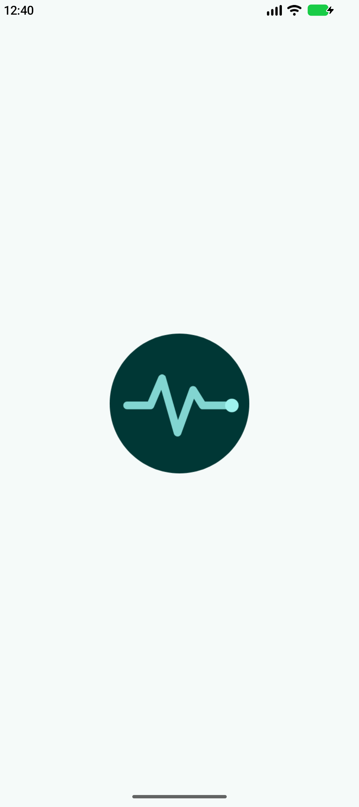
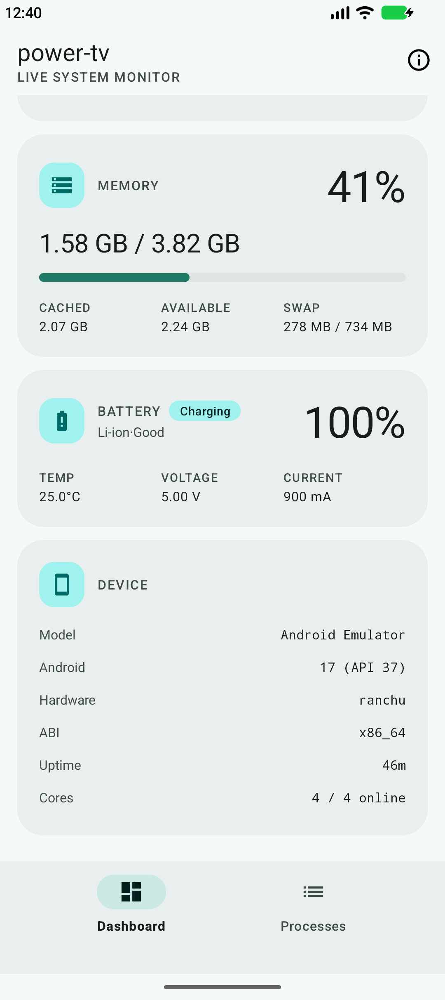
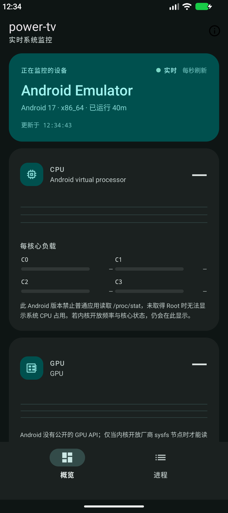
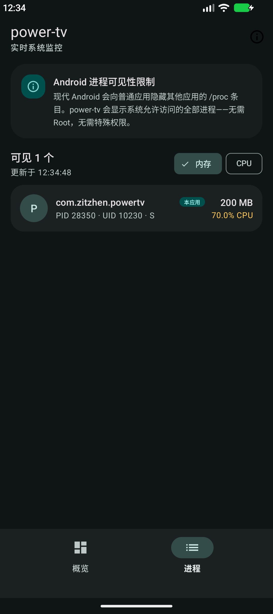

# power-tv

一款本機優先的 Android 系統監視器，靈感來自 [btop](https://github.com/aristocratos/btop)。它會在本機取樣 CPU、GPU、溫度、記憶體、電池與程序資料，並以 Material 3 介面呈現。

| [English](README.md) | [简体中文](README.zh-CN.md) | **[繁體中文](README.zh-TW.md)** |
| :---: | :---: | :---: |

| 概覽 · 淺色 | 詳情 · 淺色 |
| --- | --- |
|  |  |

| 概覽 · 深色（中文） | 程序 · 深色（中文） |
| --- | --- |
|  |  |

## 功能

- **概覽**：每秒更新，顯示即時狀態，並為 CPU、GPU、溫度與記憶體保留最近 60 個取樣點的迷你折線圖。
- **CPU**：整體與每核心負載、線上核心、目前/最高頻率與 CPU 型號。
- **GPU**：盡可能從 Adreno（kgsl）、Mali 與 devfreq sysfs 節點讀取使用率與頻率。
- **溫度**：`HardwarePropertiesManager`、可讀取的 thermal zone、電池溫度備援與系統熱狀態。
- **記憶體**：已用/總量、可用、快取與 Swap。
- **電池**：電量、充電狀態、溫度、電壓與電流。
- **程序**：列出系統允許存取的程式，可依記憶體或 CPU 排序，並說明可見性限制。
- **裝置**：廠商/型號、Android 版本、硬體、ABI、運作時間與線上核心數。
- **Shizuku（選用）**：使用者授權後，透過 ADB shell 讀取系統 CPU 統計與完整程序清單；未授權時自動退回一般讀取。
- **介面**：Material 3、淺色/深色主題、英文、簡體中文與繁體中文（香港/台灣）。
- **隱私**：所有資料只在本機處理；應用程式未宣告 `INTERNET` 權限。

## 環境需求

- Android 7.0（API 24）或更新版本。
- Android SDK Platform 37。
- JDK 24。Gradle Wrapper 使用 Gradle 9.6.0，並會在需要時透過 Foojay resolver 取得 JDK 24。
- 選用：Shizuku 11 或更新版本。power-tv 本身不要求 Root。

## 建置與執行

```bash
./gradlew assembleDebug
adb install -r app/build/outputs/apk/debug/app-debug.apk
```

也可以直接用 Android Studio 開啟並執行。執行 JVM 單元測試：

```bash
./gradlew testDebugUnitTest
```

## 選用：Shizuku

Shizuku 不會隨應用程式打包，只有在你主動授權後才會使用。

1. 安裝 Shizuku 11 或更新版本，並依 Shizuku 的指示啟動（可透過 ADB、無線偵錯或 root 啟動）。
2. 在 power-tv 中開啟「程序」頁，點選「授權」。
3. 在 Shizuku 授權視窗中允許存取，等待狀態變為已連線。

連線後，應用程式會透過執行於 ADB shell 的使用者服務讀取 `/proc/stat` 與程序資料。未連線時，介面會說明系統 CPU 使用率或程序清單無法取得的原因，而不是顯示推測值。

## 資料來源與限制

| 指標 | 資料來源 | 說明 |
| --- | --- | --- |
| CPU | `/proc/stat`、`cpufreq` sysfs、Shizuku | 部分 Android 版本會對一般應用程式隱藏 `/proc/stat`；未連線 Shizuku 時總量可能無法取得，但可讀取的頻率與線上狀態仍會顯示。 |
| GPU | 廠商 sysfs（`kgsl`、`mali`、`devfreq`） | Android 沒有公開的 GPU 使用率 API，只有核心開放節點時才有資料。 |
| 溫度 | `HardwarePropertiesManager`、thermal sysfs、電池廣播 | 感應器名稱與可用性取決於廠商核心，缺少的感應器會省略。 |
| 記憶體 | `/proc/meminfo`、`ActivityManager.MemoryInfo` | 一般應用程式權限下可穩定讀取。 |
| 電池 | `ACTION_BATTERY_CHANGED`、`BatteryManager` | 透過 sticky broadcast 讀取。 |
| 程序 | `/proc/<pid>`、Shizuku | Android 10+ 的一般應用程式通常只能看到自身程序；授權 Shizuku 後可列出全部程序。應用程式本身不要求 Root。 |

## 專案結構

```text
app/src/main/java/com/zitzhen/powertv/
├── MainActivity.kt              # Activity、底部導覽與關於對話框
├── PowerTvApp.kt                # 持有 Shizuku 連線的 Application
├── data/
│   ├── model/                   # 不可變的遙測模型
│   ├── proc/                    # /proc CPU、記憶體與程序取樣及解析
│   ├── shizuku/                 # AIDL 讀取服務與 Shizuku 生命週期
│   └── system/                  # 電池、溫度、GPU、裝置資訊與聚合
└── ui/
    ├── MonitorViewModel.kt      # 以 StateFlow 對外的每秒取樣迴圈
    ├── DashboardBinder.kt       # 概覽卡片與迷你折線圖
    ├── ProcessAdapter.kt        # 程序清單適配器
    ├── ProcessBinder.kt         # 程序頁狀態與排序
    ├── Formatters.kt            # 單位與數值格式化
    ├── LoadPalette.kt           # 負載等級配色
    └── widget/SparklineView.kt  # 自繪滾動折線圖
```

特權讀取入口定義在 `app/src/main/aidl/com/zitzhen/powertv/data/shizuku/IProcReader.aidl`。`app/src/test` 下的 JVM 測試涵蓋 `/proc` 解析器、Shizuku 資料表編解碼與格式化邏輯。

## 已知限制

- 未連線 Shizuku 時，系統 CPU 使用率與其他程序可能被隱藏；可讀取時仍會顯示每核心頻率與線上狀態。
- GPU 計數依廠商核心而異，模擬器與多數量產裝置通常無法取得。
- 溫度感應器名稱由核心提供，會原樣顯示。
- 目前沒有歷史資料持久化、桌面小工具、前景服務或通知列監控。
- power-tv 不請求 Root；Shizuku 是唯一的特權讀取方式。

